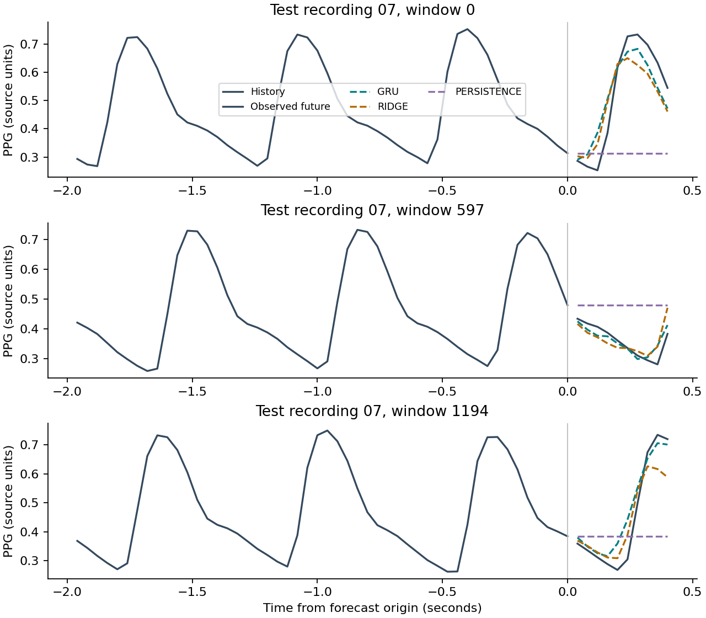

# Pulse forecast

This project trains a small gated recurrent unit (GRU) to forecast pulse-oximeter
waveforms. It evaluates whether two seconds of recent photoplethysmogram (PPG)
measurements predict the next 0.4 seconds on a held-out recording.

The data come from the [BIDMC PPG and Respiration Dataset, version 1.0.0](https://physionet.org/content/bidmc/1.0.0/)
(Pimentel et al., 2016; dataset released in 2018). The public dataset includes
53 eight-minute hospital recordings sampled at 125 Hz. This experiment downloads
seven signal CSVs and uses their `PLETH` channel. The dataset carries the
[Open Data Commons Attribution License v1.0](https://physionet.org/content/bidmc/1.0.0/).
The repository's MIT license covers the code. Raw data remain outside version control.

## Results

The demonstration run trained for 20 epochs with seed 42. Validation selected epoch
19. The GRU contains 3,690 parameters and was evaluated on 1,195 windows from
recording 07. The training and validation sets contain 5,975 and 1,195 windows.

| Model | MAE | RMSE |
| --- | ---: | ---: |
| Persistence | 0.199514 | 0.236657 |
| Ridge | 0.045748 | 0.060578 |
| GRU | 0.036788 | 0.049671 |

Errors are measured in source PPG amplitude units. The GRU reduced RMSE by 18.0%
relative to ridge and 79.0% relative to persistence on this recording. These results
describe one fixed split and one seed; they do not establish patient-level
generalization. The experiment stage took 27.4 seconds on two CPU threads in the
recorded Windows environment, excluding download and CSV parsing.



The plotted windows were selected by position before considering their forecast
errors. [The complete metric report](examples/demo/metrics.json) records the
configuration and data hashes. [The learning curve](examples/demo/learning_curve.png)
and [errors by forecast horizon](examples/demo/horizon_error.png) provide further
detail. Reproduction commands are given below.

## Reproduction

Python 3.11 or newer is required. The commands below install the CPU build of
PyTorch and run the complete experiment. No GPU, account, or paid API is required.

```powershell
python -m venv .venv
.venv\Scripts\Activate.ps1
python -m pip install torch==2.9.1 --index-url https://download.pytorch.org/whl/cpu
python -m pip install -e ".[dev]"
pulse-forecast train
```

On macOS or Linux, the environment is activated with `source .venv/bin/activate`.
The remaining commands are the same. The initial run downloads about 20 MB of raw
data. Dependency installation also downloads the CPU framework and supporting packages.
Cached CSVs are checked against PhysioNet's published SHA-256 hashes on every run.

```powershell
pulse-forecast download
pulse-forecast train --epochs 2 --output-dir runs/quick-check
pulse-forecast train --epochs 20 --seed 42 --output-dir runs/reproduction
pytest -q
ruff check src tests
```

Each run requires an empty output directory to prevent accidental replacement of
previous results. `runs/demo` is the default output directory. A run saves
`model.pt`, the fitted ridge coefficients, `metrics.json`, a Markdown summary,
test predictions, and three PNG figures. The metric report includes the seed,
split, normalization, data hashes, package versions, and elapsed time.

## Experimental design

Recordings 01–05 supply training data, recording 06 supplies validation data, and
recording 07 supplies test data. Windows are formed within individual recordings
after this split. The split is fixed before training. It has not been verified as
a split between distinct patients.

Each complete nonoverlapping block of five source samples is averaged to produce
a 25 Hz signal. Any incomplete final block is dropped. Each average is available
at the block's final sample; preprocessing never
uses samples from a later block. This boxcar smoothing reduces computation and
changes the prediction target. It is not a complete physiological signal filtering
or artifact-rejection procedure.

The training recordings determine one pooled mean and standard deviation. The
validation and test recordings use those same values. A window contains 50 history
samples and ten future samples, with a stride of ten samples. Targets within a
recording do not overlap, although adjacent windows share history. Test errors
are averaged across all forecast samples and expressed in the source PPG amplitude
units, which have no absolute clinical calibration here.

The GRU has one recurrent layer with 32 hidden units. A linear head predicts ten
offsets from the last observed value. Adam minimizes mean squared error for 20
epochs with gradient clipping. The lowest validation loss selects the checkpoint.
Test metrics are computed after training. A persistence baseline repeats the last
measurement. A ridge baseline predicts the same ten samples from all 50 history
values, with a fixed penalty of 1.0 and an unpenalized intercept.

The code runs on CPU with a fixed random seed and deterministic PyTorch operations.
Floating-point results may differ across operating systems and dependency builds.
The report records the runtime environment to support comparison.

## Scope and checks

The experiment establishes a reproducible forecasting workflow on measured
physiological data. It does not estimate respiratory rate, diagnose disease, or
validate a clinical use. One test recording and one training seed cannot establish
generalization across patients or acquisition settings. The pipeline rejects
nonfinite samples and irregular timestamps; it does not remove finite motion
artifacts. Timestamp checks allow 0.005 seconds of rounding error because the CSV
export rounds later timestamps to centiseconds; sample indices define the 125 Hz
grid. Additional patient-verified splits and repeated seeds would be required
for a broader performance claim.

Seven tests verify that prediction targets follow the history, windows remain within
recordings, held-out values cannot affect training normalization, block averaging
uses only its own samples, rounded timestamps pass while a time gap fails,
downloaded and cached files pass checksum checks, corrupt data fail verification,
and a trained checkpoint reproduces saved predictions. GitHub Actions runs these tests on small
synthetic fixtures without downloading physiological data. Demonstration results
come from the actual BIDMC recordings.

## Citation

Dataset provenance should accompany any reuse of these results. The dataset page
requests citation of Pimentel, M. A. F., et al. (2016), “Towards a Robust Estimation
of Respiratory Rate from Pulse Oximeters,” *IEEE Transactions on Biomedical
Engineering*, 64(8), 1914–1923.
[https://doi.org/10.1109/TBME.2016.2613124](https://doi.org/10.1109/TBME.2016.2613124).
The dataset DOI is [10.13026/C2208R](https://doi.org/10.13026/C2208R).
